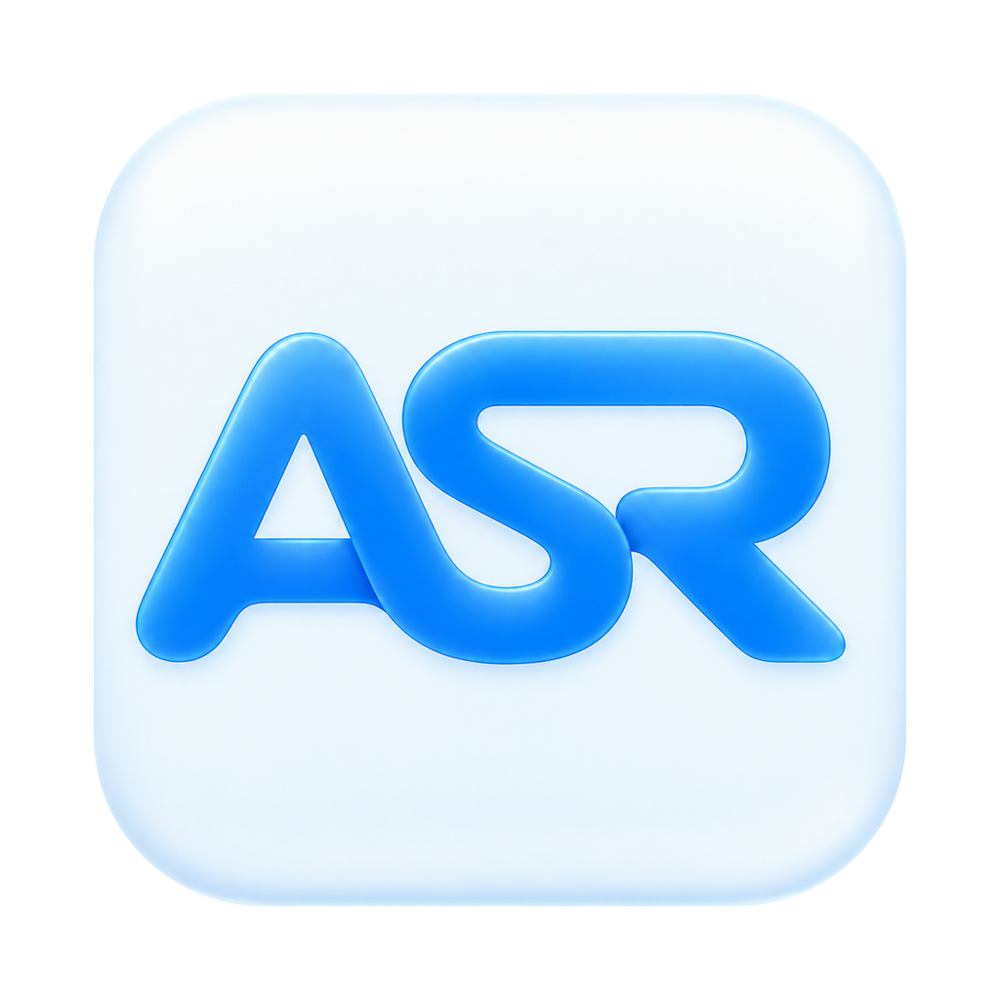
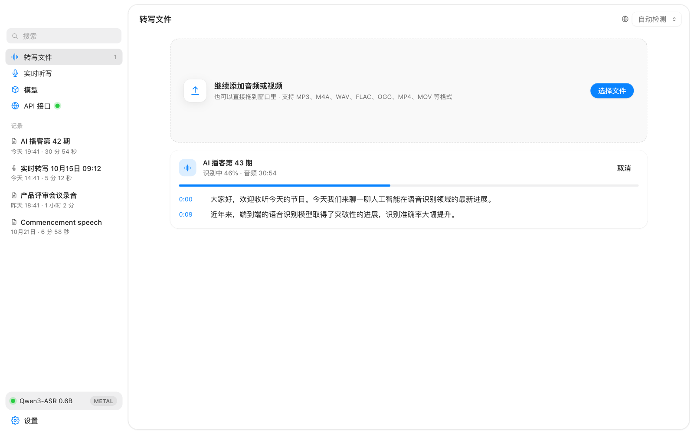
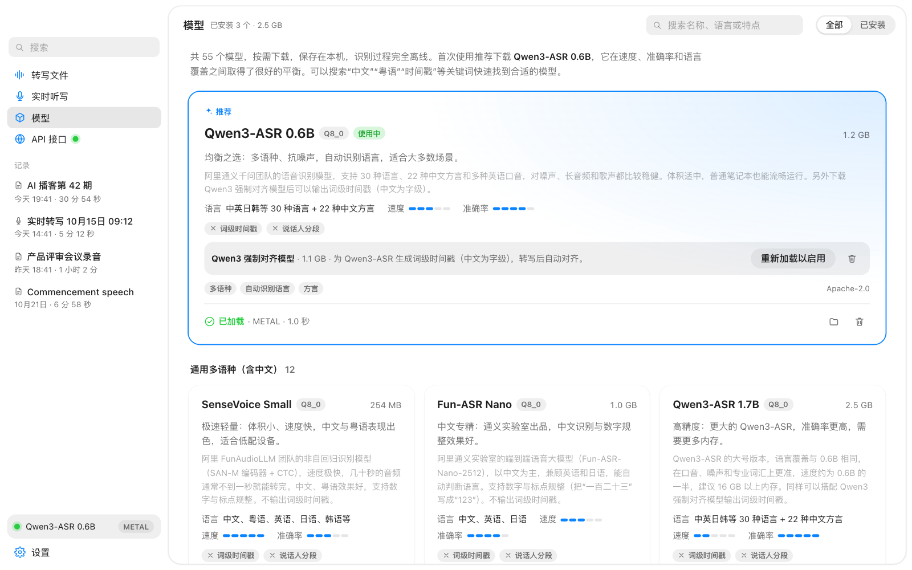
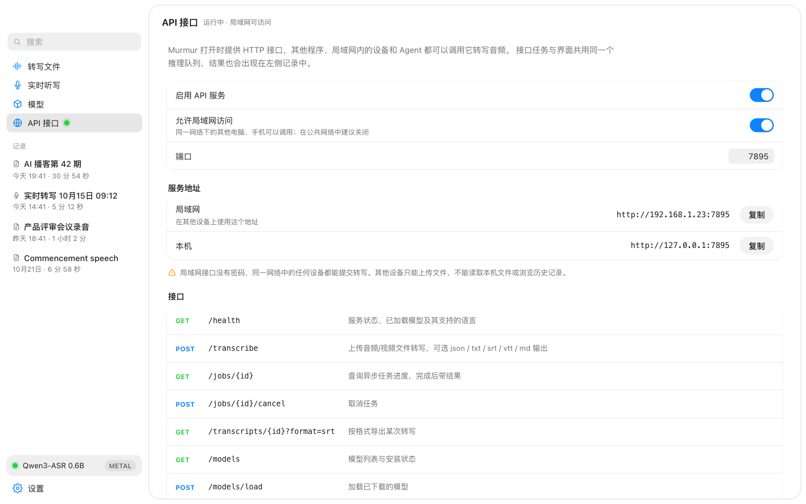
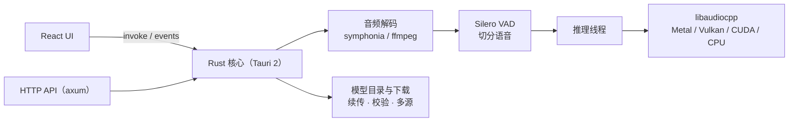

<div align="center">



# MurmurASR

**完全离线的本地语音转文字桌面应用**

55 个开源语音识别模型按需下载，支持文件转写、实时听写、字幕导出和 HTTP API。<br>
音频始终留在你的电脑上。

[](https://github.com/linyqh/MurmurASR/actions/workflows/release.yml)
[](https://github.com/linyqh/MurmurASR/releases)

[](https://tauri.app)
[](https://github.com/0xShug0/audio.cpp)

[功能](#功能) · [截图](#截图) · [模型](#模型) · [API](#api-与-agent-skill) · [开发](#开发) · [架构](#架构)

</div>

---

## 为什么选 MurmurASR

- **本地且离线**：推理在本机完成，不调用云服务，不需要账号，不按时长计费。
- **模型可选**：内置 55 个开源识别模型的目录，中文、方言、英语、欧洲语言和小语种都有覆盖，用户需要哪个就下载哪个。
- **GPU 加速**：基于 [audio.cpp](https://github.com/0xShug0/audio.cpp)（ggml）。Apple 芯片使用 Metal，Windows / Linux 使用 Vulkan 或 CUDA，没有 GPU 时自动改用 CPU。
- **可直接产出字幕**：支持词级时间戳，字幕会按停顿、标点和阅读速度自动排版，可导出 SRT / VTT。
- **可被程序调用**：内置 HTTP API 和 Agent Skill，脚本、局域网内的设备和 AI Agent 都可以提交转写任务。

## 功能

| | |
|---|---|
| **文件转写** | 拖入音频或视频（MP3、M4A、WAV、FLAC、OGG、MP4、MOV 等）即可转写，进度实时显示。内置解码器不支持的编码（HE-AAC、AC-3、WMA 等）会在首次遇到时自动下载 ffmpeg 来解码 |
| **实时听写** | 用麦克风实时转文字，说话过程中显示中间结果，检测到停顿后输出最终文字，可选择保存录音 |
| **记录管理** | 可搜索、编辑；播放时逐词高亮，点击单词可跳转播放；支持导出 TXT / SRT / VTT / Markdown / JSON |
| **字幕编排** | 结合词级时间、标点、停顿和行长切分字幕，可选单行或双行，导出结果与预览一致 |
| **模型管理** | 模型按用途分组，可搜索，每张卡片都有详细介绍；支持断点续传、SHA-256 校验，可在 Hugging Face、ModelScope、HF 镜像之间切换或自动选择下载源 |
| **API 接口** | 默认在 7895 端口提供 HTTP 服务，支持局域网访问，附带 Agent Skill |

## 截图

<table>
  <tr>
    <td width="50%"></td>
    <td width="50%"></td>
  </tr>
  <tr>
    <td align="center">文件转写：边识别边显示结果</td>
    <td align="center">模型：55 个模型按用途分组，可搜索</td>
  </tr>
  <tr>
    <td colspan="2"></td>
  </tr>
  <tr>
    <td colspan="2" align="center">API 接口：开关服务、局域网访问和调用示例</td>
  </tr>
</table>

## 快速开始

1. 在 [Releases](https://github.com/linyqh/MurmurASR/releases) 下载对应平台的安装包（macOS `.dmg`，Windows `-setup.exe`）。
2. 首次启动时按引导下载推荐模型 **Qwen3-ASR 0.6B**（1.2 GB）。国内网络建议在模型页把下载源切换为 ModelScope 或 HF 镜像。
3. 把音频或视频拖进窗口，或者切换到「实时听写」开始说话。

> 实测（Apple M6，Metal）：Qwen3-ASR 0.6B 转写 7 分钟英文约 21 秒，约为实时速度的 20 倍；SenseVoice 转写 31 秒中文约 0.6 秒。

## 模型

内置 **55 个语音识别模型 + 1 个对齐模型**，全部来自 audio.cpp 支持的开源模型。安装包里不带模型，用户在模型页选择需要的模型下载即可。

| 分组 | 代表模型 |
|---|---|
| 🌏 通用多语种（含中文） | **Qwen3-ASR 0.6B（推荐）**、Qwen3-ASR 1.7B、SenseVoice Small、Fun-ASR Nano、Confucius4-R2T2、Nemotron 3.5、Cohere Transcribe、Voxtral Realtime、CrisperWhisper、OWSM / OWSM-CTC |
| 🇬🇧 英语 | Moonshine Tiny / Small / Medium、Kroko、Niagara、Citrinet、Higgs Audio STT |
| 🇪🇺 欧洲语言 | Parakeet TDT、Canary 180M Flash、Granite Speech 5.0、Whistle、Kroko 各语种版 |
| 🎯 特定语言优化 | GigaAM（俄语及中亚语言）、Hviske（丹麦语）、QwenCleo（埃及阿拉伯语）、Kroko 希伯来语 |
| 🎙️ 长音频与说话人区分 | MOSS-Transcribe-Diarize、VibeVoice ASR、VibeVoice ASR Streaming 7B / 1.5B |
| 🔁 语音翻译 | Index-Echo S2TT 2B / 9B（中文语音直接输出英 / 西 / 日文字） |
| 🧪 音频理解大模型（实验性） | Audio Flamingo 3 / Next、Ming 3.0 Audio Tiny、FireRedAudio、LFM2.5-Audio |

**如何选**：中文和多语种场景先试 Qwen3-ASR 0.6B；机器配置低、需要更快速度时用 SenseVoice Small；要做精确字幕选 Parakeet、Granite Speech 或 CrisperWhisper，它们原生输出词级时间戳；只处理英语时选 Moonshine。

<details>
<summary><b>词级时间戳</b></summary>

- Parakeet、Kroko、GigaAM、Granite Speech、CrisperWhisper、Nemotron 原生输出词级时间戳。Nemotron 输出的是子词 token，会自动合并成词。
- Qwen3-ASR 需要额外下载 **Qwen3 强制对齐模型**（1.1 GB，在模型卡片里下载）。它支持中、粤、英、日、韩、法、德、意、葡、俄、西 11 种语言，中文按字对齐。下载后重新加载模型即可生效；某一段对齐失败时，该段会退回为不带时间戳的结果。
- 实时听写只为最终结果生成时间戳，中间结果不做对齐。
- 编辑某段文字后，该段的词级时间戳会被清除。

</details>

<details>
<summary><b>字幕编排细节</b></summary>

字幕编排模块会结合词级时间、标点、停顿、阅读速度和行长来决定字幕在哪里断开，默认每条一行，也可以切换为最多两行。切换行数会重新选择断点，并作为全局偏好保存。相邻的短片段可以合并成一条，明显的停顿处会留出空白。通用预设的目标是每行约 42 个英文字符或 16 个汉字，每条不超过 7 秒；语速过快或无法合理拆分的地方会标出提示，但不会删改识别出的文字。

记录页默认显示「字幕预览」，换行与导出的 SRT / VTT 一致。切到「原始转写 · 编辑」可以查看和修改原文。JSON 里的 `segments` 保留原始转写和词级时间，`subtitles` 保存编排后的字幕；HTTP API 返回的格式相同。词级对齐缺失、失效或不完整时，保留整段的起止时间并标注提示，只调整行内换行，不会按字数推算出更细的时间。

</details>

<details>
<summary><b>模型目录与未收录模型</b></summary>

模型目录在 `src-tauri/catalog.json`，后端和前端共用这一份。每个模型由一个或多个文件组成，每个文件都有 SHA-256，Hugging Face 链接固定到具体 commit；某个下载源返回的文件校验不通过时，会自动换下一个源。`engine/audiocpp.conf` 里的 `AUDIOCPP_MODELS` 必须包含目录中用到的每个 family，单元测试会检查这一点。

以下模型没有收录：
- audio8_asr：许可证不允许公开分发 GGUF。
- lfm3_audio：目前只在 audio.cpp 的 main 分支上，还没有进入正式 release。
- SAMSONE：音频描述模型，即使要求转写也只输出对声音的描述。
- VibeASR：需要额外传入 model spec 才能加载。

</details>

## API 与 Agent Skill

App 运行时会启动 HTTP 服务，默认端口 7895。通过接口提交的任务和界面里的任务共用同一个推理队列，结果也会保存到记录中。

```bash
curl http://127.0.0.1:7895/health

# 本机调用：直接传文件路径，不需要上传
curl -H 'Content-Type: application/json' \
  -d '{"path":"/abs/path/talk.m4a","format":"srt"}' \
  http://127.0.0.1:7895/transcribe

# 局域网内的其他设备：上传文件
curl -F file=@talk.m4a -F format=txt http://192.168.1.23:7895/transcribe
```

| 接口 | 说明 |
|---|---|
| `GET /health` | 引擎状态、已加载模型、可用语言、已安装模型 |
| `GET /models` · `POST /models/load` | 查看模型列表 · 加载已下载的模型 |
| `POST /transcribe` | 转写：JSON 传 `path`，或 multipart 传 `file`；`format` 可选 json / txt / srt / vtt / md；传 `wait=false` 时异步执行 |
| `GET /jobs/{id}` · `POST /jobs/{id}/cancel` | 查询任务进度 · 取消任务 |
| `GET /transcripts` · `GET /transcripts/{id}?format=` | 历史记录（仅限本机） · 按指定格式导出 |

> [!WARNING]
> 局域网访问默认开启，而且接口没有密码。在公共网络中，建议在「API 接口」页面关闭局域网访问。接口会拒绝带 `Origin` 头的请求，也会拒绝 `Host` 为其他域名的请求，以防网页借浏览器调用。局域网内的其他设备只能上传文件，不能读取本机路径，也不能列出历史记录。

**Agent Skill**：`skills/murmur-asr/` 包含 `SKILL.md`、完整的接口说明和不依赖任何第三方库的 Python 调用脚本。把这个文件夹复制到 Agent 的 skills 目录（例如 `~/.claude/skills/`）后，Claude 等 Agent 就能直接调用 MurmurASR 转写音频。

## 架构



| 模块 | 作用 |
|---|---|
| `src-tauri/src/commands.rs` | 命令、状态、历史记录持久化 |
| `src-tauri/src/api.rs` | 本地 HTTP 接口 |
| `src-tauri/src/models.rs` | 模型目录与下载（断点续传、校验、多下载源） |
| `src-tauri/src/audio.rs` | 解码、重采样、麦克风采集 |
| `src-tauri/src/engine/` | 专用推理线程；`ffi.rs` 运行时加载 audio.cpp C ABI，`vad.rs` 负责分段与实时断句 |

文件转写和实时听写都先用 Silero VAD 切分语音，再逐段做离线识别。这样每个模型（包括不支持流式的）都能显示进度、随时取消，并得到字幕时间戳。

## 开发

需要 Rust、Node 22、CMake；macOS 还需要 Xcode。

```bash
npm install
npm run engine:build   # 拉取 audio.cpp 最新 release 并编译（macOS 默认用 Metal）
npm run app:dev        # 启动开发版
```

只预览界面、不启动 Tauri：运行 `npm run dev`，然后打开 `http://localhost:1420/?mock=home`。可用场景有 `onboarding`、`onboarding-dl`、`models`、`jobs`、`live`；加上 `#transcript:t1`、`#settings` 这样的锚点可以直接打开对应页面。

<details>
<summary><b>测试</b></summary>

```bash
npm test && npm run typecheck
cd src-tauri && cargo test

# 用真实引擎和模型的端到端测试（没有模型时自动跳过）
MURMUR_TEST_MODEL=/path/qwen3-asr-0.6b-q8_0.gguf MURMUR_TEST_AUDIO=/path/speech.m4a \
  cargo test --release --test engine -- --nocapture
# 再加上 MURMUR_TEST_ALIGNER=/path/qwen3-forced-aligner-0.6b-q8_0.gguf，会同时校验词级时间戳

# 下载测试：下载约 254 MB，中途取消后续传，再校验 SHA-256
MURMUR_TEST_DOWNLOAD=1 cargo test --release --test download
```

</details>

<details>
<summary><b>audio.cpp 引擎版本</b></summary>

构建脚本每次都会编译 audio.cpp 最新的正式 release（`vX.Y.Z` tag），不固定版本。

- 编译指定版本：设置环境变量 `AUDIOCPP_REF`，例如 `AUDIOCPP_REF=v0.9.3`。
- 连不上 GitHub 时，脚本会沿用 `engine/vendor` 里已经检出的版本，并给出警告。
- 要编译的模型 family 列在 `engine/audiocpp.conf`。如果上游删除或改名了某个 family，CMake 会报 `Unknown AUDIOCPP_MODELS entry`，这时需要同步修改这个文件和 `catalog.json`。

</details>

<details>
<summary><b>打包与签名</b></summary>

**macOS**

```bash
./scripts/package-macos.sh   # 生成 .app 和 .dmg
```

DMG 带有安装引导背景、固定的拖拽图标位置和首次下载模型的说明。脚本首次运行时，会用 Python 3 在 `src-tauri/target/dmg-tools` 创建隔离环境并安装 `dmgbuild`。背景素材在 `assets/dmg/`，布局配置在 `scripts/dmg-settings.py`。

签名：把 `.env.macos.local.example` 复制为 `.env.macos.local`，将 `APPLE_SIGNING_IDENTITY` 设为 Developer ID Application 身份。需要公证时，先运行 `xcrun notarytool store-credentials murmur-notary` 保存凭据，再在同一个文件里设置 `MURMUR_NOTARY_PROFILE="murmur-notary"`。

**Windows**（在 PowerShell 中运行，生成 NSIS 安装程序）

```powershell
powershell -ExecutionPolicy Bypass -File scripts/package-windows.ps1              # Vulkan（默认）
powershell -ExecutionPolicy Bypass -File scripts/package-windows.ps1 -Backend cpu -RebuildEngine
```

需要 Visual Studio 2022（C++ 工作负载）、Rust、Node 22、Git；Vulkan 后端还需要 Vulkan SDK。安装程序按当前用户安装，不需要管理员权限，并随附 VC++ 运行库和 Vulkan 加载器。目标机器没有 Vulkan 驱动时，自动使用 CPU 推理。

</details>

## 平台支持

| 平台 | 推理后端 | 状态 |
|---|---|---|
| macOS（Apple 芯片） | Metal | ✅ 已在真机验证 |
| Windows x64 | Vulkan / CUDA / CPU | ✅ 已在真机验证 |
| Linux x64 | Vulkan / CPU | 🚧 已有构建脚本，CI 暂不打包，尚未在真机验证 |

`.github/workflows/release.yml` 只在推送版本 tag（如 `v0.1.11`，必须和 `tauri.conf.json` 里的版本一致）或手动运行时才会触发。它只在云端打包 Windows 安装包，并上传到一个 GitHub Release 草稿。编译好的引擎按 audio.cpp 版本缓存，上游没有发新版时，不会重新编译引擎，也不会安装 Vulkan SDK。

macOS 安装包在本机构建：确认 `.env.macos.local` 已配置签名与公证，在要发布的提交上运行 `./scripts/release-macos.sh`。脚本会打包、签名、公证 DMG，再上传到同一个版本的 Release 草稿（草稿不存在时自动创建；已发布的版本不会被覆盖）。两边都上传完成后，再手动发布草稿。

## 致谢

- [audio.cpp](https://github.com/0xShug0/audio.cpp)：基于 ggml 的纯 C++ 音频推理引擎
- [Tauri](https://tauri.app)：跨平台桌面应用框架
- Qwen、FunAudioLLM、NVIDIA、Moonshine 等团队开源的语音识别模型

模型权重遵循各自的原始许可证，具体见模型卡片。
