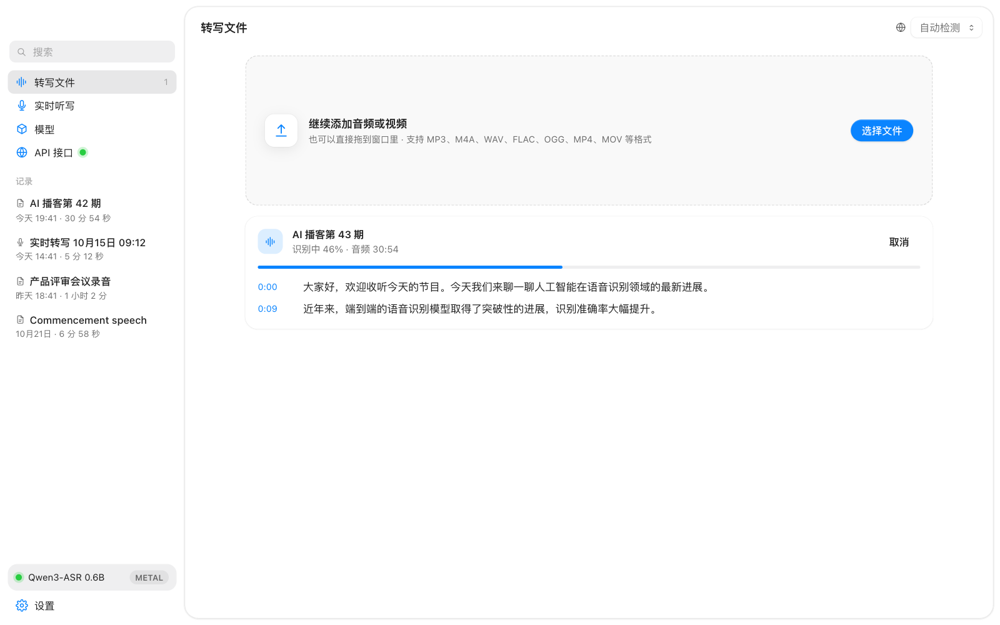
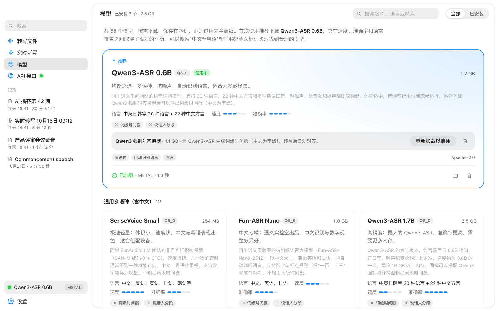
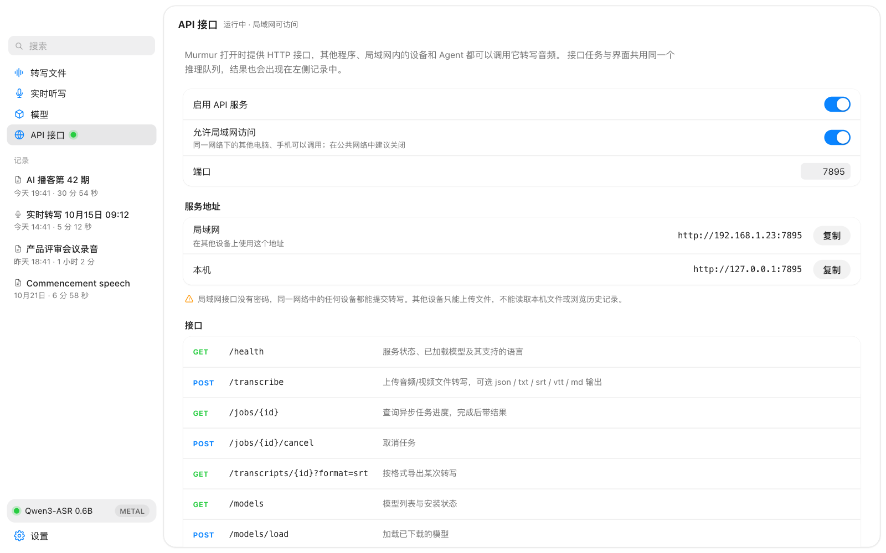
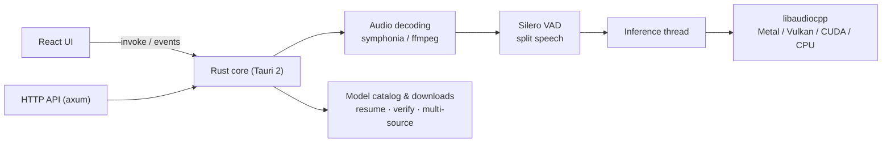

<div align="center">

English · **[简体中文](README.zh-CN.md)**


# MurmurASR

**A fully offline desktop app for speech-to-text**

55 open-source speech recognition models, downloaded on demand. File transcription, live dictation, subtitle export and an HTTP API.<br>
Your audio never leaves your computer.

[](https://github.com/linyqh/MurmurASR/actions/workflows/release.yml)
[](https://github.com/linyqh/MurmurASR/releases)

[](https://tauri.app)
[](https://github.com/0xShug0/audio.cpp)
[](LICENSE)

[Website](https://linyqh.github.io/MurmurASR/) · [Features](#features) · [Screenshots](#screenshots) · [Models](#models) · [API](#api-and-agent-skill) · [Development](#development) · [Architecture](#architecture)

</div>

---

## Why MurmurASR

- **Local and offline**: inference runs on your machine. No cloud service, no account, no per-minute fees.
- **Your choice of model**: the built-in catalog lists 55 open-source recognition models covering Chinese, dialects, English, European and lower-resource languages. Download only the ones you need.
- **GPU acceleration**: built on [audio.cpp](https://github.com/0xShug0/audio.cpp) (ggml). Metal on Apple silicon, Vulkan or CUDA on Windows and Linux, with automatic CPU fallback.
- **Subtitles out of the box**: word-level timestamps, with subtitles laid out automatically by pauses, punctuation and reading speed. Export SRT / VTT.
- **Scriptable**: a built-in HTTP API and Agent Skill let scripts, other devices on your network and AI agents submit transcription jobs.
- **English and 简体中文 interface**: follows the system language and can be switched in Settings. Adding another language only takes a folder of JSON files.

## Features

| | |
|---|---|
| **File transcription** | Drop in audio or video (MP3, M4A, WAV, FLAC, OGG, MP4, MOV, …) and watch progress in real time. Codecs the built-in decoder doesn't support (HE-AAC, AC-3, WMA, …) make the app download ffmpeg the first time one is encountered |
| **Live dictation** | Turn microphone input into text in real time: partial results while you speak, final text after a pause, with optional recording |
| **History** | Searchable and editable. Words highlight as the audio plays and clicking a word seeks to it. Export TXT / SRT / VTT / Markdown / JSON |
| **Subtitle layout** | Splits subtitles using word timing, punctuation, pauses and line length. One or two lines; exports match the preview |
| **Model manager** | Models are grouped by purpose and searchable, each with a detailed card. Resumable downloads, SHA-256 verification, and a choice of Hugging Face, ModelScope or an HF mirror (or automatic) |
| **API** | HTTP service on port 7895 by default, with optional LAN access and a bundled Agent Skill |

## Screenshots

<table>
  <tr>
    <td width="50%"></td>
    <td width="50%"></td>
  </tr>
  <tr>
    <td align="center">File transcription: results appear as they are recognized</td>
    <td align="center">Models: 55 models grouped by purpose, searchable</td>
  </tr>
  <tr>
    <td colspan="2"></td>
  </tr>
  <tr>
    <td colspan="2" align="center">API: service switch, LAN access and usage examples</td>
  </tr>
</table>

## Quick start

1. Download the installer for your platform from [Releases](https://github.com/linyqh/MurmurASR/releases) (macOS `.dmg`, Windows `-setup.exe`).
2. On first launch, follow the guide to download the recommended model **Qwen3-ASR 0.6B** (1.2 GB). If you are in mainland China, switch the download source to ModelScope or an HF mirror on the Models page.
3. Drag an audio or video file into the window, or open "Live dictation" and start talking.

> Measured (Apple M6, Metal): Qwen3-ASR 0.6B transcribes 7 minutes of English in about 21 seconds, roughly 20× real time. SenseVoice transcribes 31 seconds of Chinese in about 0.6 seconds.

## Models

The catalog has **55 speech recognition models + 1 aligner**, all open-source models supported by audio.cpp. Installers don't bundle any model; pick what you need on the Models page.

| Group | Representative models |
|---|---|
| 🌏 General multilingual (incl. Chinese) | **Qwen3-ASR 0.6B (recommended)**, Qwen3-ASR 1.7B, SenseVoice Small, Fun-ASR Nano, Confucius4-R2T2, Nemotron 3.5, Cohere Transcribe, Voxtral Realtime, CrisperWhisper, OWSM / OWSM-CTC |
| 🇬🇧 English | Moonshine Tiny / Small / Medium, Kroko, Niagara, Citrinet, Higgs Audio STT |
| 🇪🇺 European languages | Parakeet TDT, Canary 180M Flash, Granite Speech 5.0, Whistle, Kroko per-language models |
| 🎯 Language-specific | GigaAM (Russian and Central Asian languages), Hviske (Danish), QwenCleo (Egyptian Arabic), Kroko Hebrew |
| 🎙️ Long audio & speakers | MOSS-Transcribe-Diarize, VibeVoice ASR, VibeVoice ASR Streaming 7B / 1.5B |
| 🔁 Speech translation | Index-Echo S2TT 2B / 9B (Chinese speech straight to English / Spanish / Japanese text) |
| 🧪 Audio understanding LLMs (experimental) | Audio Flamingo 3 / Next, Ming 3.0 Audio Tiny, FireRedAudio, LFM2.5-Audio |

**How to choose**: for Chinese and multilingual use, start with Qwen3-ASR 0.6B. On low-end machines or when you need more speed, use SenseVoice Small. For precise subtitles pick Parakeet, Granite Speech or CrisperWhisper, which output word-level timestamps natively. For English only, choose Moonshine.

<details>
<summary><b>Word-level timestamps</b></summary>

- Parakeet, Kroko, GigaAM, Granite Speech, CrisperWhisper and Nemotron output word-level timestamps natively. Nemotron emits sub-word tokens, which are merged into words automatically.
- Qwen3-ASR needs the extra **Qwen3 forced aligner** (1.1 GB, downloaded from the model card). It supports 11 languages: Chinese, Cantonese, English, Japanese, Korean, French, German, Italian, Portuguese, Russian and Spanish, aligning Chinese by character. Reload the model after downloading it. If a segment fails to align, that segment falls back to a result without timestamps.
- Live dictation generates timestamps for final results only; partial results are not aligned.
- Editing a segment's text clears that segment's word-level timestamps.

</details>

<details>
<summary><b>Subtitle layout details</b></summary>

The subtitle layout module uses word timing, punctuation, pauses, reading speed and line length to decide where subtitles break. It defaults to one line per subtitle and can switch to at most two; switching re-selects the break points and is saved as a global preference. Adjacent short fragments can merge into one subtitle, and clear pauses leave a gap. The general preset targets about 42 Latin characters or 16 Chinese characters per line and no more than 7 seconds per subtitle. Places where speech is too fast or can't be split sensibly are flagged, but recognized text is never edited or removed.

The transcript page shows "Subtitle preview" by default, with line breaks identical to the exported SRT / VTT. Switch to "Raw transcript · Edit" to view and edit the original text. In JSON, `segments` keeps the raw transcript with word timing and `subtitles` holds the laid-out subtitles; the HTTP API returns the same format. When word alignment is missing, invalid or incomplete, the whole segment's start and end are kept and flagged, only line breaks inside it are adjusted, and no finer timing is inferred from character counts.

</details>

<details>
<summary><b>Model catalog and excluded models</b></summary>

The catalog lives in `src-tauri/catalog.json`, shared by the backend and frontend. Each model is made of one or more files, each with a SHA-256; Hugging Face links are pinned to specific commits. If a source returns a file that fails verification, the next source is tried automatically. `AUDIOCPP_MODELS` in `engine/audiocpp.conf` must include every family used in the catalog, which a unit test checks. The catalog's display text (summaries, descriptions, tags) is translated in `src/locales/<code>/catalog.json`.

These models are not included:
- audio8_asr: its license doesn't allow public distribution of the GGUF.
- lfm3_audio: only on audio.cpp's main branch so far, not yet in a release.
- SAMSONE: an audio captioning model that only describes sounds even when asked to transcribe.
- VibeASR: needs an extra model spec to load.

</details>

## API and Agent Skill

While the app is running it serves an HTTP API, on port 7895 by default. Jobs submitted through the API share the same inference queue as jobs in the UI, and results are saved to history.

```bash
curl http://127.0.0.1:7895/health

# On this machine: pass a file path, no upload needed
curl -H 'Content-Type: application/json' \
  -d '{"path":"/abs/path/talk.m4a","format":"srt"}' \
  http://127.0.0.1:7895/transcribe

# From another device on your network: upload the file
curl -F file=@talk.m4a -F format=txt http://192.168.1.23:7895/transcribe
```

| Endpoint | Description |
|---|---|
| `GET /health` | Engine status, loaded model, available languages, installed models |
| `GET /models` · `POST /models/load` | List models · load a downloaded model |
| `POST /transcribe` | Transcribe: JSON with `path`, or multipart with `file`; `format` is one of json / txt / srt / vtt / md; pass `wait=false` to run asynchronously |
| `GET /jobs/{id}` · `POST /jobs/{id}/cancel` | Job progress · cancel a job |
| `GET /transcripts` · `GET /transcripts/{id}?format=` | History (this machine only) · export in a given format |

> [!WARNING]
> LAN access is on by default and the API has no password. On public networks, turn LAN access off on the API page. The API rejects requests carrying an `Origin` header or a `Host` for another domain, so web pages can't use the browser to call it. Other devices on the LAN can only upload files; they can't read local paths or list history.

**Agent Skill**: `skills/murmur-asr/` contains `SKILL.md`, the full API reference and a Python client with no third-party dependencies. Copy this folder into your agent's skills directory (for example `~/.claude/skills/`) and agents such as Claude can call MurmurASR to transcribe audio.

## Architecture



| Module | Role |
|---|---|
| `src-tauri/src/commands.rs` | Commands, state, history persistence |
| `src-tauri/src/api.rs` | Local HTTP API |
| `src-tauri/src/models.rs` | Model catalog and downloads (resume, verification, multiple sources) |
| `src-tauri/src/audio.rs` | Decoding, resampling, microphone capture |
| `src-tauri/src/engine/` | Dedicated inference thread; `ffi.rs` loads the audio.cpp C ABI at runtime, `vad.rs` handles segmentation and live sentence breaks |

File transcription and live dictation both split speech with Silero VAD first, then recognize segment by segment offline. This way every model, including ones without streaming support, can show progress, be cancelled at any time, and produce subtitle timestamps.

## Development

Requires Rust, Node 22 and CMake; macOS also needs Xcode.

```bash
npm install
npm run engine:build   # fetch and build the latest audio.cpp release (Metal by default on macOS)
npm run app:dev        # start the dev app
```

To preview the UI without starting Tauri, run `npm run dev` and open `http://localhost:1420/?mock=home`. Available scenarios are `onboarding`, `onboarding-dl`, `models`, `jobs` and `live`; add a hash such as `#transcript:t1` or `#settings` to open that page directly.

If a release build is already installed and running, the dev app would hand off to it (the app is single-instance, keyed by bundle identifier). Run the dev build under a separate identifier instead:

```bash
npx tauri dev --config '{"identifier":"app.murmur.asr.dev","productName":"Murmur Dev"}'
```

The dev build then has its own data directory, so it starts without models or history.

### Internationalization (i18n)

The UI uses i18next. It ships English and Simplified Chinese, follows the system language by default, and can be switched under Settings → General → Interface language. Strings live in `src/locales/<language code>/<namespace>.json`; English (`en`) is the source of truth and its keys are type-checked by TypeScript. To add a language:

1. Copy `src/locales/en/` to `src/locales/<code>/` (for example `ja`), translate every JSON file, and set the language's own name in `meta.name` of `common.json`. Translate the model descriptions in `catalog.json`.
2. Run `npm test`. The tests check that every key exists, placeholders match and the whole model catalog is translated.

No code changes are needed: the language list is discovered from the directories. Backend errors are English strings; `src/lib/errors.ts` maps them to translations in the `errors` namespace, so add a mapping whenever you add a backend error.

### Landing page

`site/` holds the static landing page, published to GitHub Pages by `.github/workflows/pages.yml` on every push to `main` that touches it. Enable it once under Settings → Pages → Source: GitHub Actions. To preview locally, copy `assets/screenshots` and `assets/icon/app-icon.png` into a copy of `site/` under `assets/` and serve that folder.

<details>
<summary><b>Tests</b></summary>

```bash
npm test && npm run typecheck
cd src-tauri && cargo test

# End-to-end tests with a real engine and model (skipped automatically without a model)
MURMUR_TEST_MODEL=/path/qwen3-asr-0.6b-q8_0.gguf MURMUR_TEST_AUDIO=/path/speech.m4a \
  cargo test --release --test engine -- --nocapture
# Add MURMUR_TEST_ALIGNER=/path/qwen3-forced-aligner-0.6b-q8_0.gguf to also verify word-level timestamps

# Download test: downloads about 254 MB, cancels midway, resumes, then verifies SHA-256
MURMUR_TEST_DOWNLOAD=1 cargo test --release --test download
```

</details>

<details>
<summary><b>audio.cpp engine version</b></summary>

The build script compiles the latest audio.cpp release (a `vX.Y.Z` tag) every time; the version is not pinned.

- To build a specific version, set the `AUDIOCPP_REF` environment variable, for example `AUDIOCPP_REF=v0.9.3`.
- If GitHub is unreachable, the script keeps the version already checked out in `engine/vendor` and prints a warning.
- The model families to compile are listed in `engine/audiocpp.conf`. If upstream removes or renames a family, CMake fails with `Unknown AUDIOCPP_MODELS entry`; update this file and `catalog.json` together.

</details>

<details>
<summary><b>Packaging and signing</b></summary>

**macOS**

```bash
./scripts/package-macos.sh   # produces the .app and .dmg
```

The DMG has an install-guide background, fixed drag-icon positions and notes on downloading a model on first launch. On first run the script creates an isolated environment with Python 3 in `src-tauri/target/dmg-tools` and installs `dmgbuild`. Background assets are in `assets/dmg/` and the layout config is `scripts/dmg-settings.py`.

Signing: copy `.env.macos.local.example` to `.env.macos.local` and set `APPLE_SIGNING_IDENTITY` to your Developer ID Application identity. For notarization, run `xcrun notarytool store-credentials murmur-notary` once to save credentials, then set `MURMUR_NOTARY_PROFILE="murmur-notary"` in the same file.

**Windows** (run in PowerShell; produces an NSIS installer)

```powershell
powershell -ExecutionPolicy Bypass -File scripts/package-windows.ps1              # Vulkan (default)
powershell -ExecutionPolicy Bypass -File scripts/package-windows.ps1 -Backend cpu -RebuildEngine
```

Requires Visual Studio 2022 (C++ workload), Rust, Node 22 and Git; the Vulkan backend also needs the Vulkan SDK. The installer is per-user, needs no administrator rights, and bundles the VC++ runtime and the Vulkan loader. If the target machine has no Vulkan driver, inference falls back to the CPU automatically.

</details>

## Platform support

| Platform | Inference backend | Status |
|---|---|---|
| macOS (Apple silicon) | Metal | ✅ Verified on real hardware |
| Windows x64 | Vulkan / CUDA / CPU | ✅ Verified on real hardware |
| Linux x64 | Vulkan / CPU | 🚧 Build scripts exist; CI doesn't package it and it hasn't been verified on real hardware |

`.github/workflows/release.yml` only runs when a version tag is pushed (such as `v0.1.11`, which must match the version in `tauri.conf.json`) or when started manually. It builds only the Windows installer in the cloud and uploads it to a draft GitHub Release. The compiled engine is cached per audio.cpp version, so when upstream hasn't released a new version the engine isn't rebuilt and the Vulkan SDK isn't installed.

The macOS installer is built locally: make sure `.env.macos.local` has signing and notarization configured, then run `./scripts/release-macos.sh` on the commit being released. The script builds, signs and notarizes the DMG and uploads it to the draft Release for the same version (creating the draft if it doesn't exist; a published version is never overwritten). Once both uploads are done, publish the draft manually.

## Acknowledgements

- [audio.cpp](https://github.com/0xShug0/audio.cpp): a pure C++ audio inference engine based on ggml
- [Tauri](https://tauri.app): cross-platform desktop app framework
- The speech recognition models open-sourced by Qwen, FunAudioLLM, NVIDIA, Moonshine and other teams

## License

MurmurASR's source code is open source under the [MIT License](LICENSE). That license covers the code in this repository only.

Models are **not** part of this project and are not bundled: you download them yourself, and each model is used under **its own license**, which can differ from MIT and from other models. Some are non-commercial only. The license is shown on every model card in the app. Check that it allows your use before you use a model. See [THIRD_PARTY.md](THIRD_PARTY.md) for a summary of the model licenses and other third-party components.
